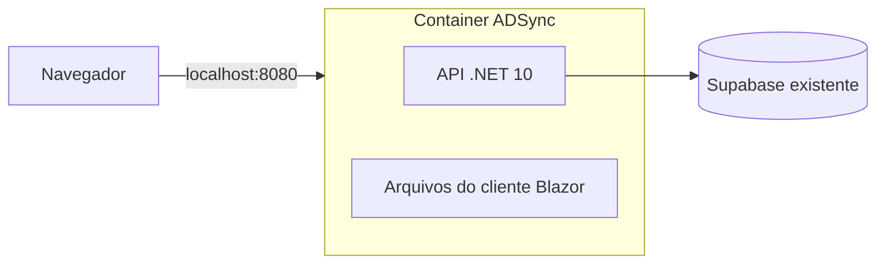

# Executar o ADSync com Docker

O projeto está preparado para **um container Linux com a API e a interface**, acessível em **http://localhost:8080**. O PostgreSQL continua no Supabase existente. Não é necessário instalar .NET, Node.js ou PostgreSQL no computador para usar este fluxo: o Docker baixa as ferramentas de compilação e monta a aplicação.



## O que cada arquivo faz

| Arquivo | Função |
| --- | --- |
| `Dockerfile` | Receita para compilar CSS, publicar API/cliente e montar a imagem final com o runtime .NET. |
| `compose.yaml` | Define imagem, configuração, porta e política de reinício do container. |
| `.dockerignore` | Limita os arquivos enviados para a construção da imagem. Exclui pastas locais, credenciais e resultados de compilação. |
| `.env.docker` | Arquivo privado criado no seu computador com conexão e chave JWT. Não entra no Git nem na imagem. |
| `.env.docker.example` | Modelo sem credenciais reais para preenchimento manual. |
| `tools/Initialize-DockerEnv.ps1` | Copia conexão e JWT dos User Secrets existentes para `.env.docker`, sem exibir valores. |

Uma **imagem** é o pacote construído com a aplicação e suas dependências. Um **container** é uma instância em execução dessa imagem. O **Compose** reúne as opções de execução para você não precisar passar cada uma no terminal.

## 1. Instalar o Docker Desktop

No Windows, instale o [Docker Desktop pelo guia oficial](https://docs.docker.com/desktop/setup/install/windows-install/), usando o mecanismo WSL 2 e containers Linux. O Docker Desktop inclui Docker Engine, CLI e Compose, conforme a [documentação de instalação do Compose](https://docs.docker.com/compose/install/).

Abra o Docker Desktop e aguarde o mecanismo iniciar. Se a instalação solicitar WSL ou reinicialização do Windows, conclua essa etapa antes de continuar. Abra um novo PowerShell e confira:

```powershell
docker --version
docker compose version
docker info
```

Este Compose usa `env_file` no formato `raw`, disponível a partir do **Compose 2.30.0**. Isso preserva caracteres como `$` nas senhas. Use uma instalação atualizada do Docker Desktop. [Referência oficial de `env_file`](https://docs.docker.com/reference/compose-file/services/#env_file).

## 2. Preparar a configuração privada

Abra o terminal na raiz do projeto:

```powershell
cd C:\Users\Diogo\Documents\Projeto-ADSync\ADSync
powershell.exe -NoProfile -ExecutionPolicy Bypass -File tools/Initialize-DockerEnv.ps1
```

O script lê **somente a conexão e a chave JWT já existentes** nos User Secrets da API e cria `.env.docker`. Não acessa o banco, não altera seus User Secrets e não sobrescreve um arquivo de destino existente. A política de execução é alterada somente para esse processo do PowerShell.

Se estiver em outro computador, sem esses User Secrets, use a alternativa manual:

```powershell
Copy-Item .env.docker.example .env.docker
notepad .env.docker
```

Preencha `ConnectionStrings__AdSync` com a connection string PostgreSQL que o projeto já usa e `Jwt__Key` com a chave JWT existente, com pelo menos 32 caracteres. Não use a URL HTTP do Supabase nem a chave `anon` como conexão PostgreSQL. Preencha os valores privadamente; não é necessário colá-los em conversas ou comandos compartilhados.

O separador `__` representa `:` na configuração .NET. Por exemplo, `Jwt__Key` fornece o valor de `Jwt:Key`. No arquivo `raw`, não coloque aspas envolvendo o valor inteiro. Aspas que já pertençam à connection string continuam fazendo parte do valor. Cada configuração deve ocupar uma única linha.

O container não herda automaticamente os User Secrets do Windows. É por isso que essa etapa é necessária. A imagem pode ser construída sem credenciais; elas são fornecidas quando o container inicia.

## 3. Construir e iniciar

Encerre a API iniciada pelo Visual Studio ou terminal antes de iniciar o container. A configuração preserva a geração automática de preventivas habilitada, como na aplicação atual; deixar duas APIs ligadas executaria dois agendadores sobre o mesmo banco.

Com o Docker Desktop aberto:

```powershell
docker compose up --build -d
```

- `up` cria e inicia a aplicação.
- `--build` constrói a imagem com o código atual.
- `-d` mantém o container em segundo plano.

Na primeira vez, o Docker precisa baixar imagens e dependências. Aguarde o comando concluir e verifique:

```powershell
docker compose ps
docker compose logs --tail=100 app
```

Abra **http://localhost:8080** e entre com a conta já existente. O cliente e as rotas `/api/...` compartilham esse endereço; não é necessário iniciar o cliente na porta 5125 nem a API na 5099.

Para conferir o estado da API:

```powershell
Invoke-RestMethod http://localhost:8080/api/runtime
```

Com a configuração gerada, o esperado é `readOnly=False`, `seedEnabled=False`, `preventiveEnabled=True` e `technicalOfflineEnabled=True`. As operações feitas na aplicação utilizam o Supabase existente, como no ambiente atual. Não há criação de banco, seed, migração ou inicialização de esquema nesse fluxo.

`127.0.0.1:8080:8080`, no Compose, significa: receber conexões na porta 8080 **deste computador** e encaminhá-las para a porta 8080 do container. A porta interna segue o padrão das imagens ASP.NET Core atuais. [Portas dos containers .NET](https://learn.microsoft.com/en-us/dotnet/core/docker/#ports).

## 4. Acompanhar, atualizar e parar

| Ação | Comando |
| --- | --- |
| Ver o container | `docker compose ps` |
| Acompanhar logs | `docker compose logs -f app` |
| Parar sem remover | `docker compose stop` |
| Iniciar novamente | `docker compose start` |
| Recompilar após mudar código | `docker compose up --build -d` |
| Aplicar mudanças no `.env.docker` | `docker compose up -d --force-recreate` |
| Parar e remover o container | `docker compose down` |

`Ctrl+C` encerra o acompanhamento dos logs, mantendo o container em execução. `down` remove o container local; os dados de negócio continuam no Supabase. Os arquivos do projeto e `.env.docker` também permanecem no computador.

## Como a imagem é construída

O Dockerfile tem três etapas. A primeira usa Node para compilar Tailwind/daisyUI com as dependências do `package-lock.json`. A segunda usa o SDK .NET 10 para publicar API e Blazor em Release. A última recebe apenas os resultados publicados e o runtime ASP.NET Core, executando com o usuário `app` da imagem oficial, sem privilégios de root.

Os arquivos do cliente ficam em `/app/client`; a API fornece esses arquivos e atende às rotas `/api`. O cliente usa sua própria origem como base da API. O fallback devolve `index.html` para rotas do cliente; endereços de API ou arquivos inexistentes continuam retornando 404. Arquivos de desenvolvimento e segredos não são enviados ao build.

O endpoint de teste `teste.html`, usado no desenvolvimento, não é servido nesse modo. Os modos anteriores de execução com Visual Studio e scripts continuam disponíveis; hospedar o cliente na API é habilitado por `Hosting__ServeClient=true` no container.

## Problemas comuns

| Sintoma | O que verificar |
| --- | --- |
| `docker` não é reconhecido | Conclua a instalação do Docker Desktop e abra um novo terminal. |
| Erro de conexão com o Docker Engine | Abra o Docker Desktop e aguarde o mecanismo iniciar. |
| Erro de WSL ou de virtualização | Siga as etapas indicadas pelo instalador oficial e reinicie o Windows quando solicitado. |
| `Virtual Machine Platform not enabled` / `No virtualization available` | Habilite a virtualização do processador na BIOS/UEFI (AMD: SVM/AMD-V). No PowerShell como administrador, execute `dism.exe /online /enable-feature /featurename:VirtualMachinePlatform /all /norestart` e reinicie. Depois abra o Docker Desktop novamente. [Guia da Microsoft](https://support.microsoft.com/en-us/windows/experience/enable-virtualization-on-windows). |
| `.env.docker` não encontrado | Execute o script da etapa 2 na raiz do projeto. |
| `format: raw` não reconhecido | Atualize o Docker Desktop/Compose para Compose 2.30.0 ou posterior. |
| Porta 8080 ocupada | Troque o lado externo no Compose para `127.0.0.1:8081:8080` e acesse `http://localhost:8081`. |
| API reiniciando ou chave JWT ausente | Consulte `docker compose logs --tail=100 app` e confira o arquivo privado. Não compartilhe valores de credenciais. |
| Falha de conexão com o banco | Confirme que a conexão é a existente do Supabase e que o container consegue alcançar seu host/porta. `localhost` dentro do container representa o próprio container. |
| Alteração no código não aparece | Reconstrua com `docker compose up --build -d`. Se a PWA indicar uma versão em espera, feche as abas e abra novamente. |

## Acesso pela internet

Este Compose foi preparado para uso local em `localhost`. Colocar a aplicação na internet também requer um servidor ou serviço de hospedagem, domínio e HTTPS. Um proxy pode terminar o HTTPS e encaminhar para a porta HTTP interna do container; essa configuração depende do servidor escolhido. A instalação e o funcionamento da PWA em outros dispositivos exigem um contexto seguro; HTTP em `localhost` atende ao desenvolvimento local. [Requisitos dos service workers](https://developer.mozilla.org/en-US/docs/Web/API/Service_Worker_API).

Uma sessão de navegador em `localhost:8080` tem armazenamento separado de `localhost:5125` ou `127.0.0.1:5180`. Faça login novamente. Se houver atendimentos pendentes no navegador usado anteriormente, sincronize-os naquele endereço antes de encerrar a API anterior; a troca de endereço não transfere a fila automaticamente.

## Validação realizada e limite

A publicação Release foi montada fora do Docker com a mesma estrutura de arquivos. O teste `tests/container-host.cjs` verificou a API e a interface na mesma origem, carregamento do WASM, autenticação, retornos 404, cache e recarga offline da PWA. A API de teste usou configuração fictícia, somente leitura, seed e agendador desligados, sem acesso ao banco. `tests/container-env.ps1` verificou a geração do arquivo privado com credenciais fictícias, caracteres especiais, secrets planos/aninhados e proteção contra sobrescrita.

Em 10/11/2026, o Docker Desktop foi instalado na máquina, mas o mecanismo Linux não iniciou: os logs informaram `Virtual Machine Platform not enabled` e `No virtualization available`. A consulta ao Windows também retornou `VirtualizationFirmwareEnabled=False` para o Ryzen 7 5700X. A imagem Linux ainda precisa ser construída e executada depois de habilitar a virtualização na BIOS/UEFI e o recurso do Windows. A validação da publicação não substitui a execução da imagem no Docker.
