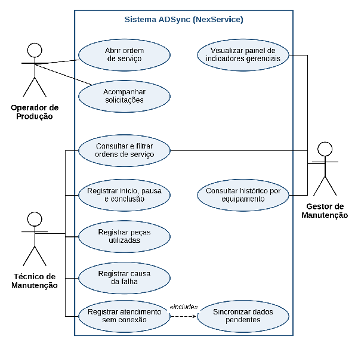
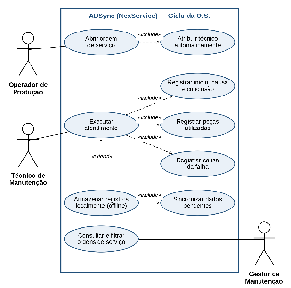
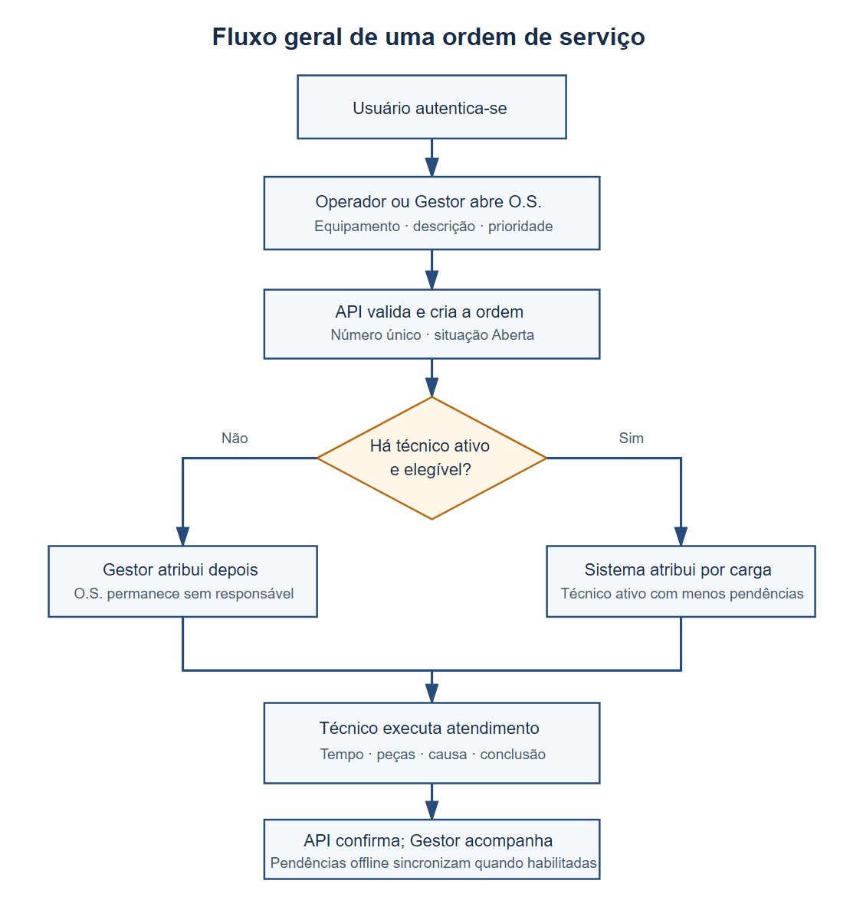
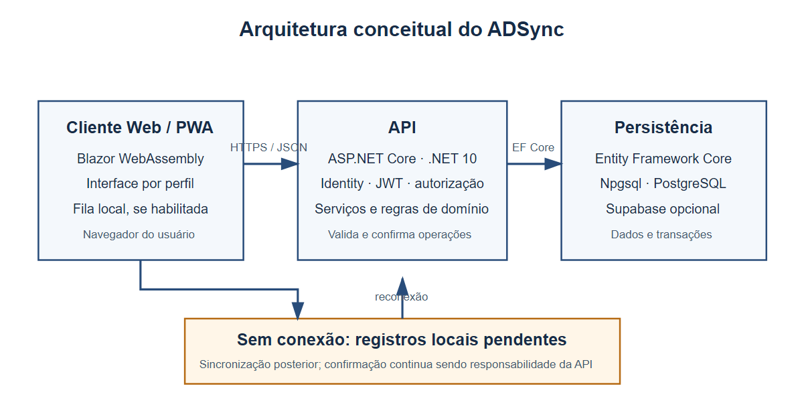
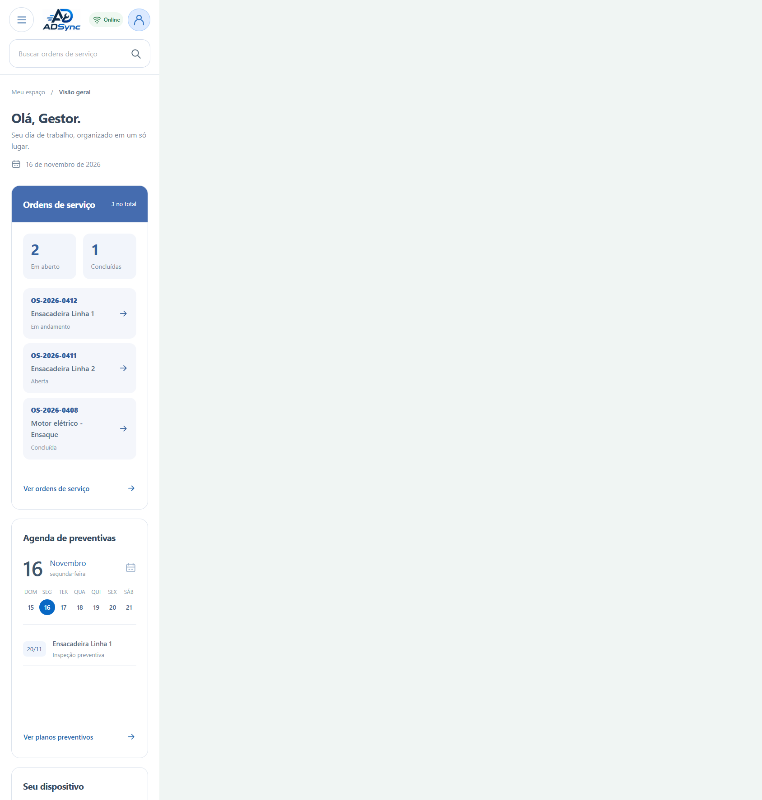
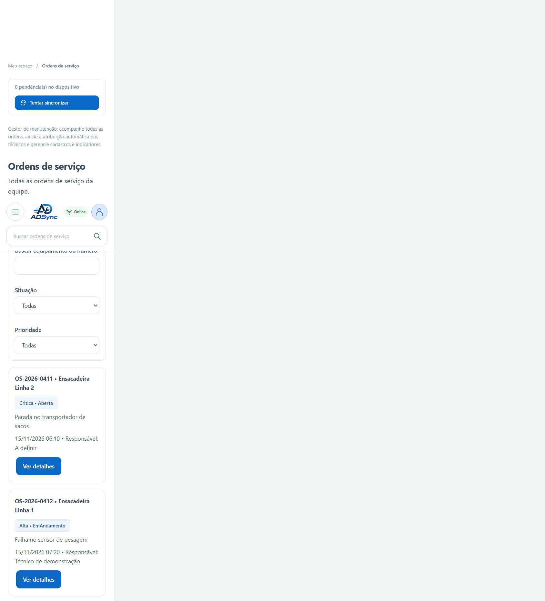

Curso Superior de Tecnologia em Análise e Desenvolvimento de Sistemas  
Projeto Integrador Interdisciplinar 2

ADSync

## Gestão de Ordens de Serviço
### NexService

**Equipe**

Daniel Pacheco da Silva Rodrigues  
Diogo Henrique de O. Cazarotte  
Lucas Borges Silva  
Matheus Basalia de Lima

Ribeirão Preto – SP  
2026/2

# Identificação do Projeto

| Campo | Informação |
|---|---|
| Nome do projeto | ADSync |
| Nome técnico do sistema | Gestão de Ordens de Serviço |
| Nome comercial | NexService |
| Curso | CST em Análise e Desenvolvimento de Sistemas – SENAI Ribeirão Preto |
| Unidades curriculares | Desenvolvimento Back-end, Frameworks Front-end, Ciência de Dados, Computação em Nuvem e Projeto Integrador Interdisciplinar 2 |
| Docente responsável | Prof. MSc. Gustavo Martins Nunes Avellar |
| Equipe | Daniel Pacheco da Silva Rodrigues; Diogo Henrique de O. Cazarotte; Lucas Borges Silva; Matheus Basalia de Lima |

## Descrição do Documento

Este documento apresenta o problema, os requisitos, os modelos, a estratégia de qualidade e o desenvolvimento do ADSync (NexService), sistema de apoio à gestão de ordens de serviço de manutenção. A proposta foi elaborada para o contexto da SustenNutri Nutrição Animal Ltda. O texto diferencia requisitos do produto, funcionalidades implementadas e itens que ainda precisam de validação com os usuários da empresa.

## Histórico de Revisões

| Versão | Data | Autor(es) | Alterações |
|---|---|---|---|
| 1.0 | 20/09/2026 | Diogo | Início da documentação do projeto. |
| 1.1 | 20/10/2026 | Diogo e Lucas | Ajustes de identificação, stakeholders, histórias de usuário, regras de negócio, diagramas, glossário e referências. |
| 2.0 | 16/11/2026 | Equipe ADSync | Conclusão dos capítulos de solução, qualidade e desenvolvimento; revisão dos casos de uso do ciclo da O.S.; inclusão de citações no contexto e motivação, ensacadeiras e telas do sistema; atualização do escopo para refletir a implementação e suas limitações. |

# 1. Introdução e Planejamento

## 1.1 Contexto do Problema

A SustenNutri Nutrição Animal Ltda. atua na produção de alimentos para animais. Nesse ambiente, a disponibilidade dos equipamentos da linha produtiva é importante para manter o fluxo de fabricação e expedição. Entre os equipamentos considerados no cenário do projeto estão as máquinas ensacadeiras do setor de ensaque, além de motores e equipamentos de moagem. Uma falha em uma ensacadeira pode interromper a etapa de acondicionamento do produto e exigir coordenação rápida entre produção e manutenção. Os nomes “Ensacadeira Linha 1” e “Ensacadeira Linha 2” aparecem como exemplos de equipamentos cadastráveis no protótipo; não substituem o inventário patrimonial oficial da empresa.

No levantamento inicial descrito pela equipe, a comunicação de falhas e o acompanhamento das intervenções não contavam com um registro digital único, padronizado e consultável. Quando o chamado é transmitido informalmente, torna-se mais difícil identificar quem solicitou o reparo, qual equipamento parou, quem foi designado, quanto tempo o atendimento permaneceu em execução ou pausa e quais peças foram consumidas. A ausência de histórico também reduz a capacidade de comparar ocorrências e planejar ações preventivas.

A manutenção contribui para a confiabilidade e a disponibilidade dos ativos, e seus conceitos e indicadores dependem de registros consistentes das falhas e intervenções (ABNT, 1994; KARDEC; NASCIF, 2012). Estudos de gestão da manutenção em ambiente industrial também destacam a necessidade de organizar informações sobre ocorrências, recursos e intervenções para orientar melhorias (VALENTIM, 2020). Por isso, o problema tratado não é apenas a abertura de um chamado: é a falta de rastreabilidade ao longo do ciclo da ordem de serviço (O.S.).

O contexto ainda inclui técnicos que podem trabalhar em áreas com conectividade instável. Uma ferramenta que dependa de conexão contínua pode dificultar a anotação de um atendimento em campo; a abordagem offline-first registra dados localmente e os sincroniza quando há conexão, desde que a aplicação e o fluxo tenham sido projetados e configurados para isso (KLEPPMANN et al., 2019; MDN WEB DOCS, [s.d.]).

## 1.2 Propósito do Sistema

O ADSync tem como propósito centralizar o ciclo de manutenção corretiva e preventiva em uma aplicação web: registrar solicitações, acompanhar a atribuição e o atendimento, manter o histórico associado aos equipamentos e disponibilizar informações de apoio à gestão.

São objetivos específicos:

- substituir a comunicação informal por ordens identificadas, com equipamento, prioridade, situação e responsável;
- registrar início, pausa, retomada e conclusão do atendimento, preservando a sequência temporal;
- registrar causa da falha e peças utilizadas, atualizando o saldo do estoque no servidor após confirmação;
- dar ao gestor visões de acompanhamento, indicadores e relatório mensal;
- oferecer cadastro de equipamentos, peças, causas, usuários e planos preventivos;
- permitir armazenamento local e sincronização posterior nos fluxos offline habilitados e configurados;
- reduzir retrabalho administrativo e facilitar a consulta do histórico, sem substituir o julgamento técnico da equipe de manutenção.

## 1.3 Escopo do Sistema

**Incluído:** autenticação e autorização por perfil; abertura e consulta de O.S.; atribuição automática ou manual; transições do atendimento; registro de peças e causa; cadastros administrativos; planos preventivos; painel de indicadores; relatório mensal; experiência PWA e filas locais para operações offline suportadas pela configuração.

**Fora do escopo desta versão:** comando ou monitoramento direto de máquinas; integração confirmada com ERP, CLP, sensores ou sistema de produção; emissão fiscal ou compra automática de peças; definição de metas de SLA pela empresa; implantação em ambiente produtivo; comprovação de disponibilidade, segurança ou desempenho em produção; e substituição do inventário oficial de ativos.

O sistema e os testes foram desenvolvidos em ambiente controlado. A existência de telas e serviços não comprova, por si só, a validação do processo com todas as pessoas usuárias, a aprovação dos indicadores pela empresa ou a autorização para gravar dados em uma base produtiva.

## 1.4 Stakeholders

As personas abaixo representam os papéis previstos. Os nomes são fictícios e não identificam funcionários da empresa.

| Persona | Papel e interesse |
|---|---|
| Paulo Henrique Souza Martins | Gestor de manutenção; distribui atendimentos, administra cadastros, acompanha pendências e analisa informações gerenciais. |
| Marcos Antônio Ribeiro Teixeira | Técnico de manutenção; atende O.S. atribuídas, registra tempos, peças, diagnóstico e conclusão. |
| Renata Oliveira Campos Dias | Operadora de produção; comunica falhas em equipamentos e acompanha as solicitações que abriu. |
| Equipe de manutenção e produção da SustenNutri | Usuárias e usuários que deverão validar vocabulário, prioridade, cadastro dos ativos e fluxos reais antes de uma implantação. |
| Equipe ADSync e docente responsável | Responsáveis pelo desenvolvimento acadêmico, avaliação e revisão da documentação. |

## 1.5 Modelo de Processo de Desenvolvimento de Software

Foi adotado um processo incremental inspirado em Lean Development. A equipe prioriza o fluxo que entrega valor operacional, implementa uma parte pequena, verifica seu comportamento e incorpora feedback antes de ampliar o escopo (POPPENDIECK; POPPENDIECK, 2003). O trabalho foi organizado em ciclos de levantamento, modelagem, implementação, verificação e revisão.

No início, o foco esteve na abertura e acompanhamento das O.S. A evolução acrescentou papéis de acesso, atribuição, registros de atendimento, estoque, planos preventivos, indicadores, relatórios e experiência offline. A revisão do texto também é incremental: os comentários docentes sobre referências, ensacadeiras, nome dos casos de uso, posição da Figura 1 e capítulo de desenvolvimento foram tratados nesta versão. A validação operacional final depende de retorno da empresa e da equipe revisora.

# 2. Engenharia de Requisitos

## 2.1 Perspectiva do Produto

O ADSync é uma aplicação web responsiva composta por cliente Blazor WebAssembly e API ASP.NET Core. O cliente envia requisições autenticadas à API, que aplica as regras de negócio e consulta ou altera os dados no PostgreSQL por meio do Entity Framework Core. A base pode ser hospedada no Supabase, mas a solução não depende de integração com o processo de automação das máquinas.

O produto é novo para o fluxo documentado, e não uma extensão de um sistema de O.S. existente informado pela empresa. Os contextos de uso são: abertura de chamados pela produção; execução e registro dos atendimentos pelos técnicos; e consulta, atribuição, administração e análise pelo gestor. A versão PWA pode armazenar determinadas ações no navegador e sincronizá-las depois. Consultas e gravações dependem da API e das permissões em vigor; operações offline não devem ser interpretadas como confirmação de gravação no servidor.

O uso de nuvem é compatível com a definição de acesso sob demanda a recursos compartilhados e configuráveis (MELL; GRANCE, 2011). A escolha concreta de provedor, política de backup, disponibilidade e configuração de produção, porém, exige validação e operação próprias.

## 2.2 Classes de Usuários

| Perfil | Responsabilidades e acesso | Conhecimento esperado |
|---|---|---|
| Gestor | Consulta todas as O.S.; atribui técnicos; mantém cadastros e usuários; gerencia preventivas; consulta indicadores e relatórios. | Conhece o processo de manutenção e os critérios de gestão; não precisa dominar programação. |
| Técnico | Consulta O.S. atribuídas; registra início, pausa, retomada, peças, causa, observações e conclusão; consulta equipamentos e planos conforme as permissões. | Conhece manutenção dos equipamentos e utiliza o fluxo guiado para registrar o atendimento. |
| Operador | Abre solicitações e acompanha somente as próprias O.S. | Utiliza o sistema para descrever a ocorrência e identificar o equipamento. |

## 2.3 Requisitos Funcionais

| ID | Requisito funcional |
|---|---|
| RF01 | O sistema deve autenticar usuários e identificar seus papéis. |
| RF02 | O sistema deve permitir que Operador ou Gestor abra uma O.S. informando equipamento, descrição e prioridade. |
| RF03 | O sistema deve atribuir automaticamente um técnico ativo elegível; o Gestor pode atribuir ou alterar o responsável pelas regras de acesso. |
| RF04 | O sistema deve permitir a consulta e o filtro de O.S. por situação, prioridade, número ou equipamento, respeitando o perfil. |
| RF05 | O sistema deve permitir ao Técnico iniciar, pausar, retomar e concluir uma O.S. atribuída a ele, registrando os eventos de tempo. |
| RF06 | O sistema deve exigir causa de falha para concluir uma manutenção corretiva e permitir observações técnicas. |
| RF07 | O sistema deve registrar as peças usadas em uma O.S. e atualizar o estoque após confirmação da operação pelo servidor. |
| RF08 | O sistema deve manter histórico de O.S., causas, tempos e peças associados ao equipamento. |
| RF09 | O sistema deve permitir registrar horas diárias efetivamente operadas por equipamento quando o recurso de MTBF por horas estiver habilitado. |
| RF10 | O sistema deve apresentar ao Gestor indicadores filtráveis por período e setor, com método e limitações descritos na interface. |
| RF11 | O sistema deve emitir relatório mensal com resumo, histórico, agenda e recomendações justificadas a partir dos dados disponíveis. |
| RF12 | O sistema deve permitir ao Gestor administrar usuários e os cadastros de equipamentos, peças e causas de falha, quando o modo de escrita estiver autorizado. |
| RF13 | O sistema deve permitir ao Gestor ou Técnico consultar e manter planos preventivos segundo as permissões aplicáveis. |
| RF14 | O sistema deve armazenar localmente as ações offline previstas e sincronizá-las com identificação idempotente quando a configuração de atendimento offline estiver habilitada. |

RF09 e RF14 são condicionais à configuração do ambiente e à disponibilidade dos dados necessários. Os indicadores implementados não representam todos os indicadores inicialmente idealizados: em particular, o produto atual não comprova SLA ou taxa de retrabalho operacional.

## 2.4 Requisitos Não Funcionais

| ID | Categoria | Requisito não funcional |
|---|---|---|
| RNF01 | Usabilidade | A interface deve apresentar navegação e formulários compreensíveis para os três perfis, com validação e mensagens de erro visíveis. |
| RNF02 | Portabilidade | O cliente web deve adaptar-se a telas de computador e dispositivos móveis com navegador compatível. |
| RNF03 | Segurança | O acesso deve exigir autenticação; as rotas da API devem autorizar cada operação por papel e escopo do usuário. |
| RNF04 | Integridade | Alterações críticas de domínio devem ser validadas no servidor; operações concorrentes e reenvios devem preservar consistência e idempotência quando aplicável. |
| RNF05 | Conectividade | A experiência offline deve informar o estado da conexão, preservar pendências locais e não apresentar como concluída uma operação ainda não confirmada pelo servidor. |
| RNF06 | Manutenibilidade | O código deve separar domínio, aplicação, infraestrutura, API e cliente, facilitando correção e evolução. |
| RNF07 | Infraestrutura | O sistema deve utilizar PostgreSQL e poder operar com serviço gerenciado, sem exigir servidor de banco local para o usuário final. Backup e recuperação continuam sendo responsabilidade operacional a definir. |

## 2.5 Histórias de Usuário

As histórias seguem o formato “Como perfil, quero ação, para benefício”, conforme Cohn (2004).

| ID | História de usuário | Requisitos |
|---|---|---|
| HU01 | Como Operador, quero abrir um chamado com equipamento, descrição e prioridade, para comunicar uma falha de forma rastreável. | RF02 |
| HU02 | Como Gestor, quero que chamados sejam distribuídos por carga dos técnicos ativos, para equilibrar a fila inicial. | RF03 |
| HU03 | Como Gestor, quero atribuir manualmente uma O.S. sem responsável, para manter o atendimento sob controle quando não houver técnico elegível. | RF03 |
| HU04 | Como Técnico, quero registrar início, pausa, retomada e conclusão, para documentar o tempo efetivamente trabalhado. | RF05 |
| HU05 | Como Técnico, quero informar causa e observações, para deixar um histórico técnico padronizado. | RF06, RF08 |
| HU06 | Como Técnico, quero registrar peças utilizadas, para manter o histórico e o saldo atualizado. | RF07, RF08 |
| HU07 | Como Operador, quero consultar apenas as solicitações que abri, para acompanhar seu andamento. | RF04 |
| HU08 | Como Técnico, quero consultar apenas as O.S. atribuídas a mim, para priorizar os meus atendimentos. | RF04 |
| HU09 | Como Gestor, quero comparar indicadores por período e setor, para acompanhar tendências com as limitações dos dados visíveis. | RF09, RF10 |
| HU10 | Como Gestor, quero consultar o relatório mensal, para examinar conclusões, pendências, peças, agenda e recomendações. | RF11 |
| HU11 | Como Gestor, quero administrar usuários e cadastros, para manter os dados operacionais atualizados. | RF12 |
| HU12 | Como Gestor ou Técnico, quero gerenciar planos preventivos, para organizar inspeções e tarefas programadas. | RF13 |
| HU13 | Como Técnico, quero preservar registros offline e enviá-los quando a conexão voltar, para não perder as anotações feitas em campo. | RF14 |

## 2.6 Regras de Negócio

| ID | Regra |
|---|---|
| RN01 | Cada O.S. recebe identificador/número único e inicia com situação “Aberta”. |
| RN02 | A atribuição automática considera técnicos ativos e a quantidade de O.S. abertas, em andamento ou pausadas. O desempate é estável; sem técnico ativo, a O.S. permanece sem responsável para atribuição manual pelo Gestor. Planos preventivos conservam o responsável configurado no plano. |
| RN03 | O Técnico só pode iniciar uma O.S. atribuída a ele; o Gestor pode consultar todas e o Operador somente as O.S. que abriu. |
| RN04 | O tempo de trabalho ativo soma intervalos entre início/retomada e pausa/conclusão; intervalos pausados e o tempo anterior ao início não entram no MTTR de trabalho ativo. |
| RN05 | Uma O.S. não pode ser concluída sem causa de falha quando o fluxo exigir diagnóstico. |
| RN06 | A baixa de estoque ocorre no servidor após validação de peça, quantidade e estado da O.S. |
| RN07 | Eventos offline têm identificador e horário de ocorrência; um reenvio idêntico não deve duplicar o efeito. Conflitos temporais ou de atribuição devem ser apresentados para revisão, não descartados silenciosamente. |
| RN08 | Horas não registradas em um dia não equivalem a zero horas; a cobertura incompleta impede o uso daquele equipamento no cálculo de MTBF por horas. |
| RN09 | A geração automática de O.S. preventivas, o seed e as gravações dependem de autorização/configuração explícita do ambiente. |

## 2.7 Casos de Uso

Os casos de uso descrevem objetivos observáveis dos atores e suas interações com o sistema (SOMMERVILLE, 2019). A autenticação é pré-condição dos fluxos protegidos e não se confunde com um caso de uso do ciclo da O.S.

### 2.7.1 Diagrama de Casos de Uso – Geral do Sistema

**Figura 1 – Diagrama geral de casos de uso do ADSync.**  
Fonte: elaborado pela equipe (2026).

### 2.7.2 Diagrama de Casos de Uso – Ciclo da O.S.

**Figura 2 – Casos de uso do ciclo da ordem de serviço.**  
Fonte: elaborado pela equipe (2026).

### 2.7.3 Descrição Textual dos Casos de Uso

#### Caso de Uso: Executar atendimento

**Atores:** Técnico de Manutenção.  
**Descrição:** executar o atendimento de uma O.S. atribuída ao Técnico. É o objetivo geral que agrupa as ações específicas do diagrama: registrar início/pausa/conclusão, registrar peças e registrar causa da falha.  
**Pré-condições:** usuário autenticado como Técnico; O.S. existente e atribuída ao usuário; cadastros de equipamento, peças e causas disponíveis conforme a operação.  
**Fluxo principal:**

1. O Técnico abre sua lista de ordens e seleciona uma O.S. atribuída a ele.
2. O sistema apresenta equipamento, descrição, prioridade, situação e histórico.
3. O Técnico inicia o atendimento; o sistema registra o evento e altera a situação.
4. Se houver interrupção, o Técnico informa o motivo da pausa; ao retornar, registra a retomada.
5. Se utilizar peça, informa item e quantidade; a API valida a operação e atualiza o estoque.
6. O Técnico registra a causa e as observações técnicas.
7. O Técnico conclui o atendimento; o sistema valida o estado e grava o evento de conclusão.
8. O sistema atualiza a O.S. e apresenta a situação confirmada.

**Fluxos alternativos:**  
A. O Técnico pausa e retoma mais de uma vez; cada evento é acrescentado ao histórico.  
B. O Técnico registra uma peça durante atendimento em andamento ou pausado, conforme as regras do domínio.

**Exceções:**  
1. A O.S. não está atribuída ao usuário: a API recusa o acesso.  
2. A situação não permite a ação ou falta causa obrigatória: a operação é recusada e a tela informa a validação.  
3. A conexão falha: a ação só fica pendente localmente quando o atendimento offline está habilitado; sem essa configuração, o Técnico deve consultar a O.S. antes de repetir a operação.

#### Caso de Uso: Abrir ordem de serviço

**Atores:** Operador de Produção ou Gestor de Manutenção.  
**Descrição:** registrar uma solicitação de manutenção para um equipamento, incluindo os dados mínimos para triagem.  
**Pré-condições:** usuário autenticado com papel autorizado; equipamento ativo e disponível para seleção.  
**Fluxo principal:**

1. O ator seleciona “Abrir chamado”.
2. Informa equipamento, descrição do problema e criticidade.
3. O sistema valida os campos e cria a O.S. com número único e situação “Aberta”.
4. O sistema seleciona técnico ativo com menor quantidade de O.S. pendentes, usando os critérios de desempate definidos.
5. O sistema mostra o número da O.S. e o resultado confirmado.

**Fluxos alternativos:**  
A. Se não houver técnico ativo, a O.S. continua aberta sem responsável e fica disponível ao Gestor para atribuição manual.  
B. Quando a abertura offline estiver habilitada, o cliente preserva o chamado no dispositivo e tenta sincronizá-lo posteriormente.

**Exceções:**  
1. Campo obrigatório inválido ou equipamento indisponível: o sistema não cria a O.S. e informa o ajuste necessário.  
2. Falha de comunicação: o formulário/pendência é preservado quando o fluxo local está habilitado; a interface não declara que a API confirmou a gravação.

#### Caso de Uso: Consultar e filtrar ordens de serviço

**Atores:** Gestor de Manutenção, Técnico de Manutenção e Operador de Produção.  
**Descrição:** localizar ordens e consultar seu estado de acordo com o escopo do perfil.  
**Pré-condições:** usuário autenticado e autorizado.  
**Fluxo principal:**

1. O ator abre a área de ordens.
2. O sistema consulta a API e aplica o escopo do papel: todas para Gestor, atribuídas ao Técnico ou abertas pelo Operador.
3. O ator pesquisa por número ou equipamento e, se necessário, filtra por situação ou prioridade.
4. O ator seleciona uma O.S. autorizada e consulta detalhes e histórico.

**Fluxos alternativos:** o ator limpa filtros ou atualiza os dados.  
**Exceções:** identificador inexistente ou fora do escopo retorna resposta sem revelar detalhes de outra pessoa; falha de rede é indicada e não deve ser apresentada como uma consulta atualizada.

# 3. Projeto da Solução

## 3.1 Fluxo de Funcionamento do Sistema

O fluxo geral conecta solicitação, atribuição, execução e análise. A atribuição ocorre após a validação da abertura; as ações técnicas são restritas ao responsável; e o Gestor acompanha os dados confirmados no servidor. A sincronização é uma alternativa condicionada à configuração offline.

**Figura 3 – Fluxo geral de uma ordem de serviço.**  
Fonte: elaborado pela equipe (2026).

Em sequência: (1) o usuário entra no sistema; (2) o Operador registra equipamento, descrição e prioridade; (3) a API valida os dados e cria a O.S.; (4) o sistema tenta atribuir o técnico com menor carga pendente; (5) o Técnico inicia, pausa/retoma e registra peças e diagnóstico; (6) o servidor valida e persiste os eventos; (7) o Gestor consulta ordens, indicadores e relatório. Se não houver conectividade, apenas os fluxos offline habilitados ficam na fila local, aguardando confirmação de sincronização.

## 3.2 Regras de Navegação

Após autenticar, a pessoa usuária acessa uma visão geral com ordens recentes, agenda de preventivas (para Gestor e Técnico), estado do dispositivo e atalhos. O menu superior abre as áreas permitidas pelo perfil.

| Área | Gestor | Técnico | Operador |
|---|---:|---:|---:|
| Visão geral | Sim | Sim | Sim |
| Ordens de serviço | Todas e atribuição | Atribuídas ao próprio Técnico | Abertas pelo próprio Operador |
| Indicadores e relatórios | Sim | Não | Não |
| Preventivas e equipamentos/peças | Sim | Sim, conforme regra | Não |
| Cadastros e usuários | Sim | Não | Não |

Os botões de ação aparecem conforme o papel e o estado da O.S. A busca rápida direciona à lista de ordens. A ação “Atualizar” refaz consultas. “Sair” encerra a sessão no navegador. A tela deve explicitar erros de conexão, gravação e sincronização.

## 3.3 Arquitetura Conceitual

**Figura 4 – Arquitetura conceitual: cliente, API e banco de dados.**  
Fonte: elaborado pela equipe (2026).

O cliente Blazor WebAssembly executa no navegador e se comunica por HTTP com a API ASP.NET Core. A API autentica por token, aplica autorização e regras de negócio nos serviços da camada Application, acessa entidades e interfaces de domínio e persiste dados pelo Entity Framework Core/Npgsql no PostgreSQL. O Supabase pode fornecer o PostgreSQL gerenciado, mas não há integração direta entre a aplicação e CLPs, sensores, balanças ou ensacadeiras. No fluxo offline, o navegador preserva as pendências previstas; a API continua sendo a autoridade para confirmação final.

## 3.4 Protótipos e Telas do Sistema

As imagens seguintes foram capturadas no cliente do projeto. As telas autenticadas foram preenchidas com registros sintéticos interceptados localmente para ilustração; não exibem dados de funcionários, clientes ou banco de produção.

**Figura 5 – Tela de acesso do ADSync.**  
Fonte: captura da aplicação (2026).

**Figura 6 – Visão geral do Gestor com dados sintéticos de demonstração.**  
Fonte: captura da aplicação; dados fictícios (2026).

**Figura 7 – Consulta de ordens de serviço com filtros e dados sintéticos.**  
Fonte: captura da aplicação; dados fictícios (2026).

**Figura 8 – Painel de indicadores com período e setores de demonstração.**  
Fonte: captura da aplicação; dados fictícios (2026).

## 3.5 Backlog de Tarefas do Produto

O ranking considera risco operacional e valor para os perfis. “Prioridade alta” não significa que a tarefa esteja concluída.

| Prioridade | Item de backlog | Critério de conclusão |
|---|---|---|
| Alta | Validar os fluxos de abertura e atendimento com Operador, Técnico e Gestor da empresa. | Participantes representativos concluem tarefas e apontam ajustes documentados. |
| Alta | Confirmar inventário, setores, prioridades e critérios de atribuição com a empresa. | Cadastros e regras aprovados por responsável operacional. |
| Alta | Homologar operações offline em celulares e navegadores usados no chão de fábrica. | Testes de desconexão, reconexão, duplicidade e conflito com resultado registrado. |
| Alta | Definir backup, restauração, monitoramento e processo de implantação. | Procedimentos testados em ambiente separado e aprovados pelo responsável. |
| Média | Definir metas e fórmulas oficiais para SLA, retrabalho e MTBF/MTTR. | Fórmulas, fontes de dados e responsáveis aprovados antes de exibir indicadores adicionais. |
| Média | Revisar a usabilidade e acessibilidade das telas com usuários. | Testes de tarefa, correções priorizadas e evidências registradas. |
| Média | Definir retenção e gestão de sessões/dados locais no dispositivo. | Política validada e comportamento testado em logout, troca de usuário e perda do dispositivo. |
| Baixa | Avaliar integração com ERP, inventário ou automação industrial. | Estudo de viabilidade, segurança e autorização; fora do escopo até aprovação. |

# 4. Qualidade e Manutenção

## 4.1 Plano de Avaliação do Sistema

A avaliação deve combinar testes automatizados, testes exploratórios no navegador, verificação de autorização, avaliação de usabilidade e homologação dos fluxos com a empresa. Os testes que gravam dados devem usar banco local isolado e contas fictícias; não devem apontar para o Supabase ou outra base produtiva sem autorização expressa e ambiente aprovado.

O repositório contém programas de verificação em `tests/`, incluindo cenários para atribuição, acesso às ordens, indicadores, relatórios, conectividade, cliente e modo somente leitura. Testes de integração com PostgreSQL devem utilizar a configuração local indicada pelo próprio projeto. A avaliação manual deve percorrer os papéis em computador e dispositivo móvel, com conectividade normal e intermitente.

Critérios gerais: regras de transição respeitadas; consulta restrita ao escopo do perfil; estoque e histórico consistentes; eventos offline preservados e sincronizados sem duplicação; indicadores calculados conforme seus dados de entrada e apresentados com limitações; erros comunicados sem sucesso aparente; e ausência de alteração acidental em bases externas.

## 4.2 Casos de Teste de Software

| ID | Condição e ação | Resultado esperado |
|---|---|---|
| CT01 – Autenticação | Informar credencial válida e, depois, inválida. | A credencial válida abre a sessão correspondente; a inválida não expõe áreas protegidas. |
| CT02 – Abertura e atribuição | Abrir O.S. com equipamento válido em ambiente de teste com técnicos ativos. | O.S. criada como aberta e atribuída pelo critério de carga; sem técnico ativo, fica sem responsável para atribuição manual. |
| CT03 – Validação do atendimento | Técnico não atribuído tenta iniciar; depois, Técnico responsável inicia, pausa e retoma. | A primeira ação é recusada; as transições autorizadas gravam eventos e mantêm a sequência temporal. |
| CT04 – Conclusão e diagnóstico | Tentar concluir sem causa; repetir com causa válida. | Primeira tentativa é recusada com mensagem; a segunda conclui e registra o diagnóstico. |
| CT05 – Peça e estoque | Registrar peça e quantidade válidas; tentar quantidade inválida ou saldo insuficiente conforme regra configurada. | Operação válida atualiza histórico e saldo uma vez; inválida é recusada e não altera o saldo. |
| CT06 – Isolamento por papel | Operador consulta O.S. de outro operador; Técnico acessa ordem de outro técnico; Gestor consulta a fila. | Operador/Técnico não obtêm dados fora do escopo; Gestor tem a visão gerencial autorizada. |
| CT07 – Offline e idempotência | Registrar evento com conectividade interrompida, reconectar e reenviar identificador já aceito. | Pendência fica preservada até confirmação; evento não é aplicado duas vezes; conflito fica explícito para revisão. |
| CT08 – Indicadores | Consultar período com e sem registros de horas diárias completas. | MTTR respeita intervalos de trabalho ativo; dias sem registro não viram zero; MTBF por horas só considera cobertura válida quando habilitado. |
| CT09 – Relatório mensal | Consultar mês completo, mês corrente e limites de calendário. | Filtros UTC, comparação e amostras seguem as regras; o relatório não apresenta dados futuros como concluídos. |
| CT10 – Modo somente leitura | Abrir a aplicação com leitura habilitada e tentar executar operação de escrita. | Consultas permitidas; gravações recusadas pela interface e API; filas antigas não são enviadas. |

## 4.3 Plano de Manutenção

| Tipo | Aplicação prevista |
|---|---|
| Corretiva | Registrar o defeito, reproduzir em ambiente isolado, corrigir, executar regressão direcionada e publicar somente após aprovação. |
| Adaptativa | Atualizar dependências, navegador, .NET, PostgreSQL ou configuração de hospedagem após avaliar compatibilidade e segurança. |
| Perfectiva | Melhorar navegação, indicadores ou relatórios com base em feedback observado, mantendo escopo e regras validados. |
| Preventiva | Revisar logs e alertas sem dados sensíveis, aplicar atualizações de segurança, verificar backups/restauração e eliminar dados de demonstração obsoletos. |

Antes de qualquer alteração de esquema, deve-se produzir e revisar a migração, fazer backup verificável e testar restauração em ambiente separado. Deve existir responsável pela configuração de segredos, pelo acesso ao banco e pela política de retenção. Não se deve habilitar seed, geração automática de ordens, sincronização ou gravação em produção sem autorização, plano de retorno e monitoramento.

## 4.4 Revisão Técnica (Peer Review)

O material recebido contém feedback do docente responsável, mas não informa uma pessoa revisora par nem a data em que a revisão por pares foi executada. Para não atribuir uma revisão inexistente, este registro distingue o feedback docente da revisão entre integrantes. A equipe deve completar o campo de revisor e a data após realizar essa atividade.

| Campo | Registro |
|---|---|
| Revisão documentada | Feedback do docente responsável, Prof. MSc. Gustavo Martins Nunes Avellar; data do feedback não informada no material recebido. |
| Revisão por pares | Pendente de registro: informar integrante revisor e data após revisão cruzada. |
| Itens revisados nesta versão | Contexto e motivação; citações e referências; escopo e menção às ensacadeiras; posicionamento da Figura 1; nomes dos casos de uso; capítulo de desenvolvimento; imagens do sistema. |
| Problemas apontados | Faltavam citações no contexto/motivação; não se destacavam as máquinas ensacadeiras; a Figura 1 deveria aparecer na página 10; os títulos textuais tratavam os atores como casos de uso em vez de descrever objetivos/ações do ciclo da O.S.; o capítulo de desenvolvimento estava pendente e não havia imagens da aplicação. |
| Ajustes realizados | Incluídas citações autor-data no contexto; ensacadeiras explicitadas com ressalva de que o inventário deve ser confirmado; Figura 1 posicionada na página 10 do arquivo final; casos textuais intitulados por ações do diagrama; adicionados capítulos 3–5 e capturas rotuladas com dados sintéticos. |
| Sugestões restantes | Registrar a revisão por pares; validar fluxos e vocabulário com usuários da empresa; confirmar fórmulas oficiais e os dados reais dos ativos antes de qualquer piloto. |

# 5. Desenvolvimento do Sistema

## 5.1 Tecnologias e Ferramentas

O cliente foi implementado em C# com Blazor WebAssembly e componentes Razor. O estilo da interface utiliza CSS, Tailwind CSS e daisyUI. A API foi construída em ASP.NET Core sobre .NET 10, com endpoints MVC, autenticação por ASP.NET Core Identity e tokens JWT. O armazenamento utiliza PostgreSQL, Entity Framework Core e o provedor Npgsql. O Supabase pode hospedar a instância PostgreSQL existente. A equipe utilizou Visual Studio/VS Code, Node.js/npm para compilar os estilos e ferramentas .NET para build e testes.

## 5.2 Organização e Integração

O repositório está dividido em projetos:

- **ADSync.Domain:** entidades, enums, exceções e interfaces do domínio;
- **ADSync.Application:** DTOs, contratos e serviços de aplicação;
- **ADSync.Infrastructure:** contexto Entity Framework, repositórios, Identity e serviços de persistência;
- **ADSync.Api:** autenticação, autorização, controllers, configuração e integração HTTP;
- **ADSync.Client:** telas Blazor, navegação, estado de sessão, consultas e experiência PWA;
- **tests/** e **tools/**: verificações automatizadas e utilitários para ambientes isolados.

As chamadas do cliente incluem o token de autenticação. A API valida identidade, papel e escopo da ordem antes de permitir a operação. Regras como atribuição, estoque, eventos de tempo, relatórios e indicadores ficam no servidor para evitar depender apenas das validações visuais do navegador.

## 5.3 Decisões Técnicas Relevantes

1. **Separação em camadas:** a separação de domínio, aplicação, infraestrutura, API e cliente reduz acoplamento e facilita testar serviços sem interface.
2. **Autorização no servidor:** esconder um botão não é considerado controle suficiente; a API também valida o papel e os dados associados ao usuário.
3. **Atribuição concorrente:** a escolha de técnico e a gravação da O.S. são coordenadas no banco para evitar distribuição inconsistente em aberturas simultâneas.
4. **Sincronização idempotente:** eventos offline recebem identificador e recibo para que reenvios possam ser reconhecidos. Eventos com ordem temporal incompatível ou perda de atribuição não são silenciosamente aceitos.
5. **Indicadores com ressalvas:** o MTTR considera trabalho ativo registrado; o “intervalo entre chamados” disponível no painel não equivale ao MTBF físico por horas de operação. O cálculo por horas requer registros diários completos e pode ficar desabilitado.
6. **Proteção de dados:** configuração de conexão e chave JWT ficam fora do cliente e do repositório; modos de leitura e gravação são controlados por configuração. Os testes de gravação usam ambiente local isolado.
7. **Offline condicionado:** armazenamento local protege a pendência, mas não significa que a API já confirmou a operação. A interface deve manter a distinção entre registro no dispositivo e sincronização confirmada.

## 5.4 Desenvolvimento e Verificação

O desenvolvimento ocorreu em incrementos: modelagem das ordens e perfis; construção de endpoints e telas; aplicação das regras de acesso; implementação de registros de atendimento e estoque; criação de preventivas, indicadores e relatório mensal; e revisão da experiência offline. Os testes automatizados exercitam regras sem depender de interface e, quando necessário, usam PostgreSQL local com dados de teste.

As capturas de tela deste documento foram feitas no cliente local com dados sintéticos. Elas ilustram o layout e a navegação, mas não constituem prova de implantação, homologação com a empresa ou medição de desempenho.

# Glossário

| Termo | Definição |
|---|---|
| API | Interface que permite ao cliente solicitar operações e dados ao servidor por HTTP. |
| Ator | Papel externo que interage com o sistema para atingir um objetivo. |
| Caso de uso | Descrição de um objetivo e da interação entre ator e sistema. |
| DTO | Objeto de transferência de dados entre componentes ou camadas. |
| Ensacadeira | Máquina que acondiciona produto em sacos; no projeto, equipamento do processo de ensaque a ser identificado no cadastro oficial. |
| Entity Framework Core | ORM .NET usado para mapear objetos do domínio para operações no banco de dados. |
| Idempotência | Propriedade que permite reenviar uma operação identificada sem aplicar novamente seus efeitos. |
| Lean Development | Abordagem de desenvolvimento que prioriza valor, ciclos curtos e redução de desperdício. |
| MTBF | Mean Time Between Failures; intervalo médio entre falhas. A medida baseada em horas exige horas efetivas de operação e critérios de falha definidos. |
| MTTR | Mean Time To Repair; no painel do projeto, média de trabalho ativo calculada a partir de registros válidos de início, pausa, retomada e conclusão. |
| O.S. | Ordem de serviço: registro de solicitação, execução e encerramento de manutenção. |
| Offline-first | Abordagem que permite registrar localmente certas operações e sincronizá-las quando a conexão retorna. |
| PWA | Progressive Web App: aplicação web que pode oferecer recursos de instalação e funcionamento offline por meio de tecnologias do navegador. |
| Persona | Representação fictícia de um perfil de usuário. |
| PostgreSQL | Sistema gerenciador de banco de dados relacional utilizado pelo ADSync. |
| SLA | Service Level Agreement; nível de serviço acordado. As metas oficiais da empresa ainda não foram definidas para o projeto. |
| Stakeholder | Pessoa, grupo ou organização com interesse ou impacto no projeto. |
| Supabase | Plataforma que pode hospedar e administrar serviços sobre PostgreSQL; não substitui a necessidade de configurar segurança e operação. |

# Referências

ASSOCIAÇÃO BRASILEIRA DE NORMAS TÉCNICAS. **ABNT NBR 5462: confiabilidade e mantenabilidade – terminologia**. Rio de Janeiro: ABNT, 1994.

COHN, M. **User stories applied: for agile software development**. Boston: Addison-Wesley, 2004.

IBGE. Instituto Brasileiro de Geografia e Estatística. **Acesso à Internet e à televisão e posse de telefone móvel celular para uso pessoal 2024: PNAD Contínua – Tecnologia da Informação e Comunicação**. Rio de Janeiro: IBGE, 2025. Disponível em: https://biblioteca.ibge.gov.br/visualizacao/livros/liv102193_informativo.pdf. Acesso em: 16 nov. 2026.

KARDEC, A.; NASCIF, J. **Manutenção: função estratégica**. 4. ed. Rio de Janeiro: Qualitymark, 2012.

KLEPPMANN, M.; WIGGINS, A.; VAN HARDENBERG, P.; MCGRANAGHAN, M. Local-first software: you own your data, in spite of the cloud. In: ACM SIGPLAN INTERNATIONAL SYMPOSIUM ON NEW IDEAS, NEW PARADIGMS, AND REFLECTIONS ON PROGRAMMING AND SOFTWARE (ONWARD!), 2019, Athens. **Proceedings** [...]. New York: ACM, 2019. p. 154–178. Disponível em: https://inkandswitch.com/local-first/. Acesso em: 16 nov. 2026.

MDN WEB DOCS. **Offline and background operation**. Mozilla, [s.d.]. Disponível em: https://developer.mozilla.org/en-US/docs/Web/Progressive_Web_Apps/Guides/Offline_and_background_operation. Acesso em: 16 nov. 2026.

MELL, P.; GRANCE, T. **The NIST definition of cloud computing**. Gaithersburg: National Institute of Standards and Technology, 2011. (NIST Special Publication 800-145). Disponível em: https://doi.org/10.6028/NIST.SP.800-145. Acesso em: 16 nov. 2026.

POPPENDIECK, M.; POPPENDIECK, T. **Lean software development: an agile toolkit**. Boston: Addison-Wesley, 2003.

SOMMERVILLE, I. **Engenharia de software**. 10. ed. São Paulo: Pearson, 2019.

VALENTIM, M. M. **Propostas para melhoria da gestão da manutenção em uma indústria de produtos de higiene pessoal**. 2020. 61 f. Trabalho de Conclusão de Curso (Bacharelado em Engenharia Mecânica) – Universidade Tecnológica Federal do Paraná, Londrina, 2020. Disponível em: https://repositorio.utfpr.edu.br/jspui/bitstream/1/24087/1/gestaomanutencaoindustriahigiene.pdf. Acesso em: 16 nov. 2026.
